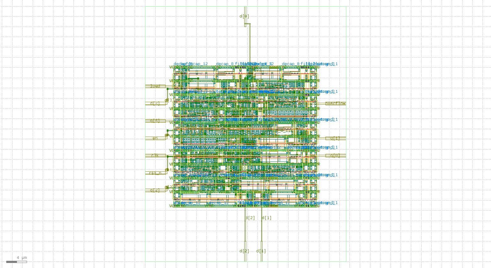
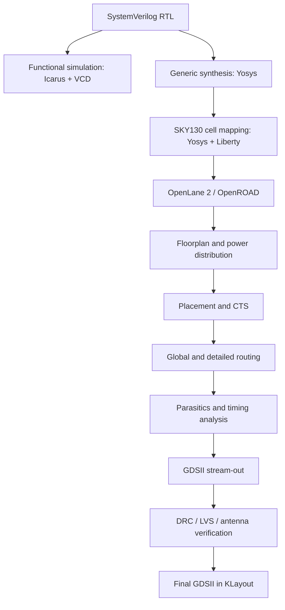
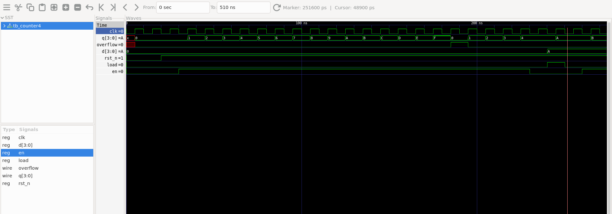
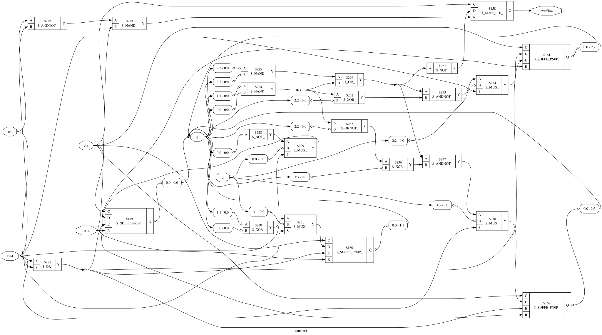
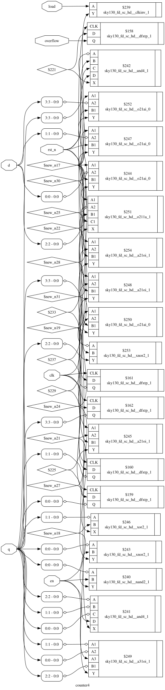
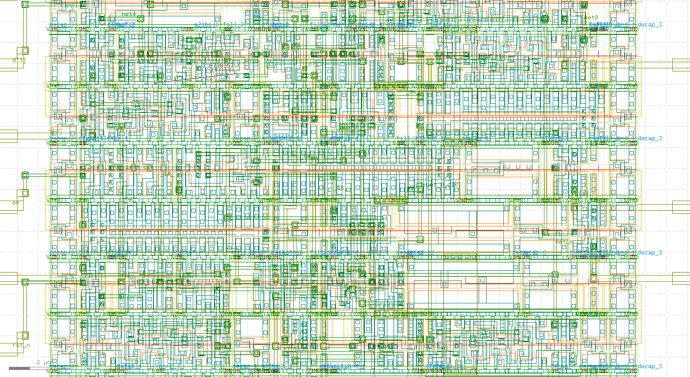

# 4-Bit Synchronous Up-Counter | RTL-to-GDSII ASIC Implementation

**An end-to-end open-source digital ASIC implementation using SystemVerilog, Yosys, SkyWater SKY130A, OpenLane 2, OpenROAD, and KLayout.**

   



*Figure 1. Actual final Counter4 GDSII viewed in KLayout, from the archived implementation.*

## At a glance

| Design / result | Recorded value | Design / result | Recorded value |
|:--|--:|:--|--:|
| Technology | SKY130A | Standard-cell library | `sky130_fd_sc_hd` |
| Clock constraint | **20 ns (50 MHz target)** | Completed OpenLane stages | **78 / 78** |
| Final standard-cell area | **399.133 µm²** | Final core utilization | **52.30%** |
| Setup worst slack | **+13.999 ns** | Hold worst slack | **+0.136 ns** |
| Final DRC errors | **0** | LVS errors | **0** |
| Antenna violations | **0** | Final deliverable | [`counter4.gds`](results/counter4.gds) |

> **Scope of claims:** These are archived tool-reported results, not new rerun results or commercial foundry signoff. A 20 ns constraint is a **target**, not a measured maximum operating frequency. Setup/hold figures are under the flow's configured analysis.

## Contents

1. [What this project does](#what-this-project-does)
2. [Architecture and RTL behavior](#architecture-and-rtl-behavior)
3. [Toolchain and prerequisites](#toolchain-and-prerequisites)
4. [Repository contents](#repository-contents)
5. [Implementation: RTL to GDSII](#implementation-rtl-to-gdsii)
6. [Measured results and engineering interpretation](#measured-results-and-engineering-interpretation)
7. [Verification results](#verification-results)
8. [Reproduce the flow](#reproduce-the-flow)
9. [Project images](#project-images)
10. [References](#references)

## What this project does

The project implements a **4-bit synchronous binary up-counter** from synthesizable RTL to a physical ASIC layout. The goal is to connect the major stages of the digital VLSI flow: functional simulation, technology-independent synthesis, SKY130 standard-cell mapping, floorplanning, placement, clock-tree synthesis (CTS), routing, parasitic extraction, static timing analysis (STA), DRC, LVS, and GDSII stream-out.

The design includes a synchronous active-low reset, enable-controlled counting, parallel load, and a registered one-cycle overflow indicator. Unlike a purely behavioral counter demonstration, this repository preserves **the mapped netlists, real physical output views, timing metrics, and final layout**.

### End-to-end flow



## Architecture and RTL behavior

Source: [`rtl/counter4.sv`](rtl/counter4.sv) · Testbench: [`tb/tb_counter4.v`](tb/tb_counter4.v)

| Port | Direction | Width | Description |
|:--|:--|--:|:--|
| `clk` | Input | 1 | Rising-edge clock |
| `rst_n` | Input | 1 | **Synchronous** active-low reset |
| `en` | Input | 1 | Increment enable |
| `load` | Input | 1 | Parallel load request |
| `d` | Input | 4 | Data to load |
| `q` | Output | 4 | Registered counter state |
| `overflow` | Output | 1 | Registered pulse on enabled `15 → 0` rollover |

**Control priority:** `reset > load > increment > hold`.

| Condition at rising edge | Next `q` | Next `overflow` |
|:--|:--|:--|
| `rst_n = 0` | `0` | `0` |
| `rst_n = 1`, `load = 1` | `d` | `0` |
| `rst_n = 1`, `load = 0`, `en = 1` | `(q + 1) mod 16` | `1` only if previous `q = 15` |
| Otherwise | Previous `q` | `0` |

A synchronous reset changes state **only at the active clock edge**. Loading `4'hF` does not itself generate overflow; the following enabled increment does. The implementation uses **five state bits**: four for `q` and one for `overflow`.

## Toolchain and prerequisites

The archived implementation was developed in **Ubuntu under WSL2**, with Docker integration and a Python 3.12 environment for OpenLane 2.

| Tool | Role |
|:--|:--|
| Icarus Verilog + GTKWave | RTL simulation and waveform inspection |
| Yosys + Graphviz | Generic and SKY130-mapped synthesis / schematic export |
| SKY130A / `sky130_fd_sc_hd` | Process and standard-cell technology files |
| OpenLane 2 + Docker | Reproducible flow orchestration |
| OpenROAD | Floorplan, placement, CTS, routing, STA |
| Magic, Netgen, KLayout | Physical verification, GDSII inspection |

Install the tools and PDK using their **official documentation** (links at the end). This repository is **not** an automated installer; tool/PDK versions were not fully pinned in the archive. The original Yosys technology-mapping script uses an absolute local Liberty path and must be adapted on other systems.

Quick checks:

```bash
python --version
docker version
yosys -V
iverilog -V
klayout -v
python -m openlane --dockerized --smoke-test
```

## Repository contents

```text
.
├── README.md
├── config.json                         # Archived OpenLane 2 configuration
├── rtl/counter4.sv                     # Synthesizable SystemVerilog
├── tb/tb_counter4.v                    # Functional stimulus testbench
├── sim/tb_counter4.vcd                 # Recorded VCD waveform
├── synth/                              # Scripts, netlists, DOT and SVG schematics
├── reports/                            # Recorded generic Yosys log
├── images/                             # Real layout and GTKWave screenshots
├── results/
│   ├── metrics.json                    # Recorded OpenLane metrics
│   ├── metrics.csv
│   ├── counter4.gds
│   └── final/                          # DEF, GDS, LEF, ODB, SPICE, SPEF, SDC, SDF, Liberty, netlists
└── .gitignore
```

The original full intermediate `runs/` history is not included in this compact GitHub package. **The final design outputs and metrics are included.**

## Implementation: RTL to GDSII

### 1 — Write and simulate the RTL

Compile the actual testbench from the repository root:

```bash
mkdir -p sim
iverilog -g2012 -s tb_counter4 -o sim/tb_counter4.vvp \
  rtl/counter4.sv tb/tb_counter4.v
vvp sim/tb_counter4.vvp
gtkwave sim/tb_counter4.vcd
```

The stimulus testbench uses a **10 ns simulation clock**; the physical-design timing constraint is **20 ns**. These are independent settings. The archived VCD demonstrates the applied signals and counter transitions, but the testbench is **not a comprehensive self-checking regression**.



*Figure 2. Actual GTKWave screenshot from the uploaded project, showing the simulated clock, counter output, reset, enable, load, and overflow signals.*

**Interpretation:** Observe reset behavior at rising clock edges, increment while enabled, parallel-load priority, hold behavior, and the registered overflow pulse when the count wraps.

### 2 — Generic logic synthesis

```bash
yosys -s synth/yosys_counter4.ys 2>&1 | tee reports/yosys_generic.log
```

Yosys parses and checks the design, flattens/synthesizes it, and exports a generic netlist and schematic. This demonstrates the transformation from behavioral sequential logic to combinational and register primitives.



*Figure 3. Generic synthesized logic produced by Yosys.*

### 3 — SKY130 technology mapping

The separate technology-mapping step maps logic to cells in the SKY130 high-density library. It uses Liberty definitions, flip-flop mapping (`dfflibmap`), and ABC combinational mapping.

```bash
# First update the Liberty path in the cleaned script to your local SKY130A PDK.
yosys -s synth/yosys_counter4_sky130.ys \
  2>&1 | tee reports/yosys_sky130.log
```

**SKY130 Technology Mapping:** The RTL design was synthesized using Yosys and mapped to the `sky130_fd_sc_hd` standard-cell library. The synthesis script performs technology mapping, logic optimization, design checks, and generation of the SKY130-mapped netlist and circuit schematic. Update the local Liberty library path before rerunning the script.

**Recorded standalone mapping:** five flip-flops; **202.6944 library area units**. This value is not the final placed-cell area.



*Figure 4. SKY130 standard-cell mapped schematic from the archived synthesis.*

### 4 — Configure the physical design

Archived [`config.json`](config.json):

```json
{
  "DESIGN_NAME": "counter4",
  "VERILOG_FILES": ["dir::rtl/counter4.sv"],
  "CLOCK_PORT": "clk",
  "CLOCK_PERIOD": 20.0,
  "pdk::sky130A": {
    "STD_CELL_LIBRARY": "sky130_fd_sc_hd",
    "FP_CORE_UTIL": 35
  }
}
```

The 20 ns clock constraint corresponds to a **50 MHz design target**. `FP_CORE_UTIL = 35` is the requested floorplanning utilization, **not** the measured final utilization.

### 5 — Run OpenLane 2 under Docker

```bash
# Replace this example virtual-environment path with your own installation.
source ~/openlane-venv312/bin/activate
python -m json.tool config.json
python -m openlane --dockerized config.json
```

The recorded run `RUN_2026-10-19_18-42-41` completed **78/78 stages**. Its physical-design stages included:

| Stage | What it accomplishes |
|:--|:--|
| Synthesis | Converts RTL to library cells |
| Floorplan and PDN | Establishes die/core geometry and power distribution |
| Placement | Places standard-cell instances |
| CTS | Builds clock distribution and adds clock cells |
| Global / detailed routing | Connects placed cells using routed metal |
| Extraction / STA | Evaluates interconnect parasitics and timing |
| GDSII | Streams physical geometry to final layout |
| DRC / LVS / antenna | Checks geometry, connectivity, and antenna rules |

### 6 — Inspect the final GDSII

```bash
klayout results/counter4.gds
```



*Figure 5. Actual zoomed GDSII screenshot. Inspect the placement rows and physical interconnect geometry.*

Other archived outputs include [`results/final/def/counter4.def`](results/final/def/counter4.def), [`results/final/nl/counter4.nl.v`](results/final/nl/counter4.nl.v), [`results/final/sdc/counter4.sdc`](results/final/sdc/counter4.sdc), and extracted SPEF/SDF/Liberty views in `results/final/`.

## Measured results and engineering interpretation

The following physical values come from [`results/metrics.json`](results/metrics.json), apart from the separately recorded standalone Yosys area.

| Metric | Recorded result | Meaning |
|:--|--:|:--|
| OpenLane progress | **78/78** | Completed recorded automated stages |
| Target clock period | **20 ns** | Constraint, not measured Fmax |
| Target core utilization | **35%** | Initial floorplan request |
| Final standard-cell instances | **52** | Includes physical implementation cells |
| Sequential cells | **5** | 4 count bits + overflow register |
| Standalone Yosys mapped area | **202.6944** | Separate mapping stage / library area units |
| Final instance area | **399.133 µm²** | Physical-flow cell area |
| Core area | **763.232 µm²** | Area within core boundary |
| Die area | **1963.55 µm²** | Entire die boundary |
| Final utilization | **52.2951%** | Instance area / core area |
| Routed wirelength | **538 µm** | Reported aggregate routing |
| Worst setup slack | **+13.99894 ns** | Positive in configured timing analysis |
| Worst hold slack | **+0.13556 ns** | Positive in configured timing analysis |
| Setup / hold TNS | **0 / 0** | No negative slack in reported metrics |
| Estimated total power | **~57.17 µW** | Model/activity-dependent tool estimate |
| Final detailed-route DRC errors | **0** | Final iteration passed; earlier iteration had 4 |
| Magic / KLayout DRC errors | **0 / 0** | Reported physical-rule checks passed |
| LVS errors | **0** | Extracted connectivity matched comparison netlist |
| Antenna violating nets / pins | **0 / 0** | Reported antenna checks passed |

### What can we infer?

**Utilization increased from the target 35% to 52.30%.** The former is a floorplanning input, while the latter is a final measured ratio: `399.133 / 763.232 ≈ 52.30%`. Clock and repair cells and the fixed core geometry contribute to the difference. This is not by itself a failed configuration.

**Final area exceeds standalone Yosys area.** The **202.6944** value is from a standalone synthesis/mapping stage; **399.133 µm²** is from the completed physical flow. They are not apples-to-apples measurements. Physical implementation adds clock and optimization cells, and OpenLane can use different synthesis settings.

**Timing checks passed under their constraints.** Positive setup and hold slack and zero TNS indicate no violations in the reported analysis. These figures **do not** establish a tested silicon frequency or unrestricted Fmax.

**The design reached a clean final physical-verification state.** Zero reported final DRC, LVS, and antenna violations support the success of the automated flow. They do not substitute for foundry tapeout signoff or exhaustive functional/formal verification.

**Power is an estimate.** The ~57 µW figure is model- and activity-dependent, not a measurement of a fabricated chip.

## Verification results

| Check | Evidence | Recorded result |
|:--|:--|:--|
| RTL functional simulation | Testbench and VCD waveform | Completed |
| Generic and SKY130 synthesis | Yosys logs, netlists and schematics | Completed |
| OpenLane 2 physical implementation | Final metrics and design views | 78/78 stages completed |
| Detailed-route DRC | Final metrics | 0 errors |
| Magic / KLayout DRC | Final metrics | 0 / 0 errors |
| LVS | Final metrics | 0 errors |
| Antenna checks | Final metrics | 0 violating nets / pins |
| Setup / hold STA | Final metrics | +13.99894 ns / +0.13556 ns worst slack |

## Reproduce the flow

From the extracted repository root:

```bash
# 1. Functional simulation
mkdir -p sim reports
iverilog -g2012 -s tb_counter4 -o sim/tb_counter4.vvp \
  rtl/counter4.sv tb/tb_counter4.v
vvp sim/tb_counter4.vvp

# 2. Generic Yosys synthesis
yosys -s synth/yosys_counter4.ys 2>&1 | tee reports/yosys_generic.log

# 3. SKY130 standalone synthesis (edit Liberty path first)
yosys -s synth/yosys_counter4_sky130.ys \
  2>&1 | tee reports/yosys_sky130.log

# 4. Full physical implementation (after installing OpenLane 2 + PDK)
python -m openlane --dockerized config.json

# 5. Final archived layout inspection
klayout results/counter4.gds
```

A fresh OpenLane run generates a new `runs/` directory. This repository contains **the archived final views**, not all intermediate steps of the historical run. Ensure Docker, the PDK, and OpenLane 2 are installed and compatible; the repository does not pin an identical toolchain environment.

## Project images

### Images already included (actual project evidence)

| Figure | File | Where used |
|:--|:--|:--|
| Full GDSII layout | [`images/counter4_full_layout.png`](images/counter4_full_layout.png) | README cover |
| Simulation waveform (VCD-derived) | [`images/counter4_vcd_waveform.png`](images/counter4_vcd_waveform.png) | Simulation |
| Generic Yosys schematic | [`synth/counter4_generic.svg`](synth/counter4_generic.svg) | Generic synthesis |
| SKY130-mapped schematic | [`synth/counter4_sky130.svg`](synth/counter4_sky130.svg) | Technology mapping |
| Zoomed GDSII | [`images/counter4_zoomed_layout.png`](images/counter4_zoomed_layout.png) | Layout inspection |

## References

- [OpenLane 2 documentation](https://openlane2.readthedocs.io/)
- [OpenROAD documentation](https://openroad.readthedocs.io/)
- [Yosys documentation](https://yosyshq.readthedocs.io/)
- [TechSimplified TV — Install and Run Yosys in Ubuntu Linux 22.04](https://www.techsimplifiedtv.in/2024/12/install-run-yosys-in-ubuntu-linux-2204.html?m=1) — supplementary Yosys installation and usage reference for generic synthesis and SKY130 technology-mapping setup.
- [SkyWater open-source PDK](https://github.com/google/skywater-pdk)
- [Volare PDK manager](https://github.com/efabless/volare)
- [KLayout](https://www.klayout.de/)

---

**Project outcome:** A documented **4-bit synchronous up-counter** progressed from RTL and simulation to SKY130-mapped logic, routed standard cells, passing recorded physical checks, and a final GDSII layout. The repository includes the original engineering evidence so the implementation can be inspected and studied.
